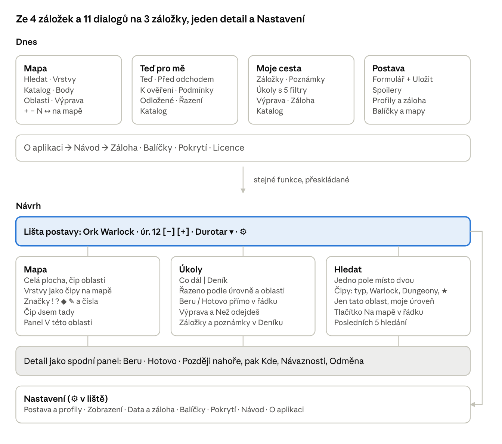

# Návrh jednoduššího ovládání – Forever průvodce

Stav k 26. 10. 2026 · aplikace 0.16.0-audit (kód 17), data 8 · autor Jenda
Původní dokument: [Claude Docs](https://claude.ai/artifact/7jeMKZs7RQNugJ3e93RqZg). Tento soubor je jeho kopie pro práci v repozitáři; při rozporu platí novější z obou.

## Shrnutí

Aplikace umí hodně, ale nejčastější úkony při hraní jsou schované v dialozích a obrazovka „Teď pro mě“ je s daty 8 prakticky prázdná. Návrh zmenšuje aplikaci na 3 záložky, jeden detail a jedno hledání. Žádná funkce ani data nezmizí, jen se přeskládají podle toho, co se dělá nejčastěji.

Šest změn s největším efektem:

1. **Úroveň a oblast v horní liště** – úroveň tlačítky − / +, oblast jedním klepnutím, ukládá se hned.
2. **Stav úkolu nahoře** – Beru / Hotovo / Později jako první tlačítka v detailu i přímo v seznamu.
3. **Jedna záložka Úkoly** místo „Teď pro mě“ a „Moje cesta“, řazená podle úrovně a oblasti.
4. **Jedno hledání** místo dvou (Hledat na mapě a Katalog).
5. **Mapa přes celou plochu**, značky podle významu (! zadání, ? odevzdání), hotové úkoly skryté.
6. **Jedno Nastavení** pro zálohu, profily, balíčky, návod a pokrytí.

Fáze 1 (sekce Pořadí prací) jsou malé, bezpečné úpravy, které jdou stihnout před spuštěním hry 4. 11.

## Současný stav

Dnes má aplikace 4 záložky (Mapa, Teď pro mě, Moje cesta, Postava) a 11 funkcí v dialozích: Katalog, Hledat, Vrstvy, Body, Oblasti, Výprava, Profily a záloha, Balíčky a mapy, Návod, Pokrytí, Licence. V kódu je 23 volání `AlertDialog`. Dialogy se otevírají z dialogů (Návod → Záloha, Výprava → detail z katalogu) a stejná funkce má více vstupů: záloha 3, pokrytí 2, výprava 2.

Kolik stojí běžné úkony (klepnutí, bez psaní a posouvání):

| Úkon | Dnes | Po změně |
| --- | --- | --- |
| Zvýšit úroveň o 1 | 3 + přepsat číslo + sjet dolů k tlačítku Uložit postavu | 1 (+ v liště) |
| Změnit aktuální oblast | 4 + najít oblast + sjet dolů k Uložit postavu | 2 (oblast v liště), z mapy 1 |
| Označit úkol jako hotový | 4 + napsat název + sjet v dialogu pod popis | 1 v seznamu Úkoly, 3 přes hledání |
| Zjistit, co dělat dál | 2, ale „Dostupné kroky“ jsou prázdné a „K ověření“ má kolem 3 500 položek | 1, seznam pro úroveň a oblast |
| Najít, kde je postava nebo NPC | 3 + napsat název (pole se musí ťuknout) | 2 + napsat název (pole je aktivní hned) |
| Uložit zálohu | 3 (Postava → Profily a záloha → Uložit) | 2 (Nastavení → Uložit zálohu) |

Čísla jsou spočítaná z kódu obrazovek (`GuideScreen.kt`, `CharacterScreens.kt`, `CatalogDialog.kt`, `RecommendationsScreen.kt`), ne změřená na telefonu.

## Nalezené problémy

Největší problém není vzhled, ale to, že doporučení s daty 8 nic nedoporučí. Seřazeno od nejzávažnějšího:

1. **„Teď pro mě“ je prázdné.** `Recommendations.kt` dá každé položce stav „K ověření“, pokud není potvrzená ve vydané hře, a data 8 jich mají 0. Sekce Dostupné kroky a záložka Podmínky proto zůstanou prázdné a vše spadne do „K ověření“ (Před odchodem ukáže jen jeho výběr): pro Durotar zhruba 3 500 položek (1 845 předmětů, 1 198 NPC, 316 úkolů).
2. **Seznam nebere ohled na úroveň.** U neověřených položek se úroveň při řazení nepoužije. Simulace nad daty 8 ukazuje warlockovi na úrovni 1 v Durotaru mezi prvními 20 položkami úkoly „Doomcaller's …“ pro úroveň 60. Je to výpočet podle kódu, na telefonu to ještě ověř.
3. **Stav úkolu je pod popisem.** V detailu jde typ, popis, štítek ověření a teprve pak „Tvůj záznam úkolu“ s volbou Hotovo. Na screenshotu `qa/e10c/e10c-voidwalker.png` už tlačítka nejsou vidět bez posunu.
4. **Mapa má málo místa.** Nad ní jsou 2–3 řádky ovládání, na ní 4 tlačítka (+ − N ↔), Výprava a informační rámeček, pod ní nápověda, copyright, panel detailu (až 210 dp) a spodní lišta.
5. **Značky ukazují zdroj, ne význam.** Všechny jsou stejné červené kruhy 48 dp, písmeno říká C = Classic, ? = komunitní, ≈ = přibližná. Ve WoW ale „?“ znamená odevzdání úkolu, takže značka mate. Splněné úkoly zůstávají na mapě.
6. **Postava má zbytečná pole.** Režim a Profese jsou volný text, ale žádné z 2 829 pravidel v datech 8 je nepoužívá. Formulář navíc vyžaduje tlačítko Uložit postavu a hlídá neuložené změny.
7. **Dvě hledání nad stejnými daty.** „Hledat“ na mapě a „Katalog“ prohledávají stejný index, každé s jinými filtry (jen tato oblast × Warlock, Dungeony, úroveň, záložky).
8. **Upozornění u každé položky.** Neověřená jsou všechna data, takže štítek „Reference z Classicu — Forever čeká na ověření“ na každé kartě nic nerozlišuje. Slova ověření/potvrzení/reference jsou v kódu obrazovek 53×.
9. **Zastaralé texty.** Návod mluví o „Data 7“ a instalaci „přes E09“, O aplikaci o „testovacím vydání E13“. Aplikace je 0.16.0 s daty 8.
10. **Nastavení na třech místech.** Míra spoilerů je v Postavě, Řazení v Teď pro mě, záloha ve třech obrazovkách. Balíčky nabízejí stahování z HTTPS odkazu, i když veřejný server podle README neexistuje.

## Nová struktura

Místo 4 záložek a 11 dialogů budou 3 záložky – **Mapa, Úkoly, Hledat** – a nad nimi lišta postavy. Všechno, co se dělá jednou za čas, se přesune do jedné obrazovky Nastavení.



Totéž jako text:

```text
DNES
  Mapa ........ Hledat · Vrstvy · Katalog · Body · Oblasti · Výprava · + − N ↔ na mapě
  Teď pro mě .. Teď · Před odchodem · K ověření · Podmínky · Odložené · Řazení · Katalog
  Moje cesta .. Záložky · Poznámky · Úkoly s 5 filtry · Výprava · Záloha · Katalog
  Postava ..... Formulář + Uložit · Spoilery · Profily a záloha · Balíčky a mapy
  O aplikaci → Návod → Záloha · Balíčky · Pokrytí · Licence

NÁVRH
  Lišta postavy: Ork Warlock · úr. 12 [−] [+] · Durotar ▾ · ⚙
  ├─ Mapa ..... celá plocha, čip oblasti · vrstvy jako čipy · značky ! ? ◆ ✎ a čísla
  │             · čip Jsem tady · panel V této oblasti
  ├─ Úkoly .... Co dál | Deník · řazeno podle úrovně a oblasti · Beru / Hotovo v řádku
  │             · Výprava a Než odejdeš · záložky a poznámky v Deníku
  ├─ Hledat ... jedno pole místo dvou · čipy: typ, Warlock, Dungeony, ★
  │             · jen tato oblast, moje úroveň · tlačítko Na mapě · posledních 5 hledání
  ├─ Detail (společný pro všechny záložky): spodní panel, nahoře Beru · Hotovo · Později,
  │             pak Kde, Návaznosti, Odměna
  └─ Nastavení (⚙ v liště): Postava a profily · Zobrazení · Data a záloha · Balíčky
                · Pokrytí · Návod · O aplikaci
```

Z každé záložky vede stejný detail jako spodní panel, takže úkol se vždy ovládá stejně, ať ho najdeš na mapě, v seznamu nebo hledáním.

## Obrazovka po obrazovce

### Horní lišta postavy (na všech záložkách)

- Jeden řádek: **Ork Warlock · úr. 12 [−] [+] · Durotar ▾ · ⚙**.
- − / + mění úroveň a hned ukládá. Oblast otevře výběr oblasti s hledáním a také hned ukládá. Tlačítko Uložit postavu zmizí.
- Máš-li víc profilů, klepnutí na jméno je přepne. ⚙ otevře Nastavení.

### Mapa

- Mapa od okraje k okraji. Nad ní jen čip s oblastí a lupa (otevře Hledat).
- Vypnout otáčení mapy (`enableRotation()` v `MapComposeEngine.kt`); odpadne tlačítko N. Zůstane malé „celá mapa“, přiblížení gesty.
- Vrstvy jako jeden řádek čipů na mapě: **Úkoly · Postavy · Doprava · Moje**. Hotové úkoly jsou ve výchozím stavu skryté.
- Seznam „Body (24)“ nahradí vytahovací panel „V této oblasti“.
- Když prohlížíš jinou oblast, než je oblast postavy, objeví se čip **Jsem tady** – jedním klepnutím ji nastaví.
- Značky podle role: **!** zadání úkolu, **?** odevzdání, ◆ cíl úkolu nebo zdroj předmětu, ✎ poznámka, číslo = zastávka výpravy. Vizuálně kolem 32 dp, dotyková plocha zůstane 48 dp. Role je v datech už teď ve vazbách (2 218 zadání, 2 386 odevzdání).
- Classic / komunitní původ se přesune ze značky do detailu.
- Nápověda „Podrž volné místo…“ jen při prvním spuštění. Copyright zůstane jako drobný text v rohu mapy a celý v O aplikaci.

### Úkoly (nahradí Teď pro mě a Moje cesta)

Nahoře přepínač **Co dál | Deník**.

**Co dál** – jeden seznam po sekcích:

1. Rozpracované – tvoje úkoly ve stavu Beru.
2. Warlock – třídní úkoly a kouzla do tvé úrovně + 2.
3. Tady – úkoly v oblasti postavy do úrovně + 2.
4. Brzy – úroveň + 3 až + 5, sbalené.
5. Bez známé úrovně – sbalené.

- Každý řádek: název, úroveň, oblast a tlačítka **Beru / Hotovo**. Klepnutí otevře detail.
- V seznamu jen úkoly a kouzla. NPC a předměty jsou dostupné přes detail úkolu a Hledat. Pro Durotar to znamená 316 úkolů místo 3 500 položek, a po filtru úrovně jednotky až desítky.
- Na konci tlačítko **Než odejdeš z Durotaru**: rozpracované, nesplněné třídní a přání v oblasti.
- Záložky K ověření a Podmínky zmizí; nejistota je vidět v detailu.

**Deník** – Rozpracované / Hotové / Odložené (čipy), Záložky a přání, Poznámky a Výprava. Filtr „Všechny úkoly (2 799)“ odpadne, na to je Hledat.

### Hledat (nahradí Hledat na mapě i Katalog)

- Jedno pole, pod ním čipy: **Vše · Úkoly · Postavy · Předměty · Warlock · Dungeony · ★ Moje**, přepínače „Jen tato oblast“ a „Moje úroveň“.
- Řádek výsledku: název, typ, oblast, úroveň a tlačítko **Na mapě**. Klepnutí otevře detail.
- Prázdné pole ukáže posledních 5 hledání a tvoje poznámky.

### Detail (jeden pro bod na mapě, výsledek hledání i úkol)

- Spodní panel ve dvou výškách: polovina a celá obrazovka. Žádný dialog v dialogu; související záznam se otevře ve stejném panelu se šipkou Zpět.
- Nahoře název, typ a úroveň, hned pod tím akce podle typu: úkol **Beru · Hotovo · Později**, předmět **Mám · Chci**, místo **Na mapě**. Druhý řádek: ★, Do výpravy, Poznámka.
- Pod tím rozbalovací části: Kde (zadání, odevzdání, cíle), Návaznosti, Odměna, Popis (podle spoilerů), Zdroje a ověření.
- Po změně stavu krátká lišta „Hotovo · Vrátit“ na 5 s místo tlačítka Vrátit poslední změnu. Potvrzení zůstane jen tam, kde změna ovlivní navazující úkoly (jako dnes).

### Nastavení (⚙ v liště)

- **Postava** – jméno, rasa, profily. Režim a Profese skrýt, dokud je data nepoužijí.
- **Zobrazení** – míra spoilerů, řazení doporučení, nezhasínat displej.
- **Data a záloha** – Uložit zálohu, Obnovit ze zálohy, místní snímky, Pokrytí, Balíčky. Stahování z HTTPS odkazu a volba Wi-Fi pod „Pokročilé“.
- **Návod** (5 krátkých bodů) a **O aplikaci** (verze, data, licence, copyright).

## Další prvky pro zjednodušení

Tyto drobnosti nic nepřidávají do dat, jen ubírají klepnutí a čtení:

- **Jedno upozornění místo desítek.** Proužek nahoře v Úkolech: „Data z bety a Classicu, ve hře zatím neověřená“ s odkazem na Pokrytí, jde zavřít. Štítek u položky jen při výjimce: rozpor zdrojů (3 položky) nebo potvrzeno ve hře.
- **První spuštění na jedné obrazovce.** Rasa (Ork předvybraný), úroveň 1, oblast Durotar a tlačítko Začít. Odpovídá původnímu plánu „bez dlouhého dotazníku“.
- **Nezhasínat displej**, když je otevřená mapa. Při hraní s telefonem vedle počítače se hodí.
- **Připomínka zálohy.** V Nastavení „Poslední záloha: před 12 dny“ a jemná výzva po 7 dnech, pokud od té doby přibyly změny.
- **Skutečné ikony v navigaci** místo textových znaků ◎ ◇ ☆ ◉.
- **Přetažení zastávek výpravy** místo tlačítek ↑ a ↓ u každé zastávky.
- **Méně výjimek pro velké písmo.** S menším počtem prvků odpadne většina zvláštních rozložení (`compactHeader`, `compactMap`, `compactDetail` v `GuideScreen.kt`).
- **Pravidlo pro texty:** nejvýš jedna vysvětlivka na obrazovku, jedna věta. Podrobnosti patří do Návodu.

## Pořadí prací

Každou fázi stavět jako samostatnou větev, nechat proběhnout Android checks v GitHub Actions a vyzkoušet na telefonu, než začne další.

**Fáze 1 – před spuštěním 4. 11.** (malé úpravy, navigace zůstává):

- [x] Úroveň − / + a výběr oblasti v horní liště, okamžité uložení.
- [x] V detailu úkolu přesunout volbu stavu nad popis.
- [x] V doporučeních řadit a filtrovat podle úrovně i u neověřených položek; v seznamu jen úkoly a kouzla.
- [x] Jedno globální upozornění místo štítku u každé karty.
- [x] Skrýt pole Režim a Profese.
- [x] Vypnout otáčení mapy, odstranit tlačítko N, schovat nápovědu pod mapou.
- [x] Aktualizovat Návod a O aplikaci na data 8, bez zmínek o E09 a E13.

Implementace: [UI_FAZE_1.md](UI_FAZE_1.md), verze 0.17.0-ui1 (18). Automatické kontroly prošly. Jenda dne 26. 10. 2026 po předání APK potvrdil „Vše funguje jak má“; základní funkčnost Fáze 1 na telefonu je přijatá.

**Fáze 2 – nová kostra:**

- [x] 3 záložky (Mapa, Úkoly, Hledat), lišta postavy a obrazovka Nastavení.
- [x] Sloučit Hledat a Katalog do jedné obrazovky.
- [x] Detail jako spodní panel, bez dialogů v dialozích.
- [x] Úkoly s přepínačem Co dál / Deník.

Implementace: [UI_FAZE_2.md](UI_FAZE_2.md), verze 0.18.0-ui2 (19). Automatické kontroly prošly. Jenda dne 26. 10. 2026 po předání APK potvrdil „Ok, funguje to“; základní funkčnost Fáze 2 na telefonu je přijatá.

**Fáze 3 – mapa a pohodlí:**

- [ ] Značky podle role, skrytí hotových úkolů.
- [ ] Panel „V této oblasti“ a čip Jsem tady.
- [ ] Lišta Vrátit a seznam Než odejdeš.
- [ ] První spuštění, připomínka zálohy, nezhasínat displej.

## Co zachovat a na co dát pozor

Změny se týkají jen obrazovek. Databáze, formát zálohy, balíčky a herní data zůstávají, jak jsou.

Zachovat:

- Provoz bez internetu, oddělená osobní data, zálohu s místními snímky a balíčky s náhledem a návratem.
- Poctivé značení nejistých údajů – jen přesunuté do detailu a jednoho proužku.
- Podporu velkého písma a široké obrazovky.

Pozor při úpravách:

- **Testy klikají přes `testTag`.** 21 testovacích souborů hledá prvky 394× (nejčastěji `catalog`, `catalog_query`, `nav_CHARACTER`, `save_profile`). Kde funkce zůstává, ponechat stejný tag; kde zmizí, upravit testy ve stejném kroku.
- **Uložená navigace.** `Session.history` ukládá názvy MAP, NOW, JOURNEY, CHARACTER. `load()` neznámé hodnoty už zahazuje, takže nové záložky starou instalaci neshodí – jen to ověřit testem.
- **Okamžité ukládání úrovně.** Rychlé klepání na + nesmí narazit na `isBusy` v `saveProfile`; ukládat se zpožděním zhruba 300 ms po posledním klepnutí.
- **Datum poslední zálohy** patří do `Session` (DataStore s `ignoreUnknownKeys`), ne do zálohy samotné.

## Kontext pro práci s AI

Kde v kódu co je (cesty od `app/src/main/java/cz/jenda/wowforever/`):

| Oblast návrhu | Soubory |
| --- | --- |
| Navigace, hlavička, mapa, detail bodu, O aplikaci | `ui/GuideScreen.kt`, záložky v `data/SessionStore.kt` (`Destination`) |
| Teď pro mě | `ui/RecommendationsScreen.kt`, logika `domain/Recommendations.kt` |
| Postava a Moje cesta | `ui/CharacterScreens.kt` |
| Katalog a detail položky | `ui/CatalogDialog.kt`, stav úkolu a odměny `ui/ProgressPanels.kt` |
| Hledat na mapě, Vrstvy, poznámky | `ui/MapDialogs.kt`, výběr oblasti `ui/MapSelectorDialog.kt` |
| Výprava | `ui/ExpeditionDialog.kt`, `domain/Expedition.kt` |
| Záloha, balíčky, návod, pokrytí | `ui/BackupDialog.kt`, `ui/PackagesDialog.kt`, `ui/HelpDialog.kt`, `ui/ContentCoverageDialog.kt` |
| Značky a otáčení mapy | `map/MapComposeEngine.kt` |
| Stav aplikace a ukládání | `GuideViewModel.kt` |

Odhady „3 500 položek“, „316 úkolů“ a pořadí „Doomcaller's …“ pocházejí ze simulace v Pythonu nad `catalog.json` z dat 8 (spojené `bundled-data-8.wfp.part*.wfpart`). Simulace přebírá výpočet oblastí a řazení z `domain/Recommendations.kt`, ale polohy bere z `locations` místo `atlas.points`. Před úpravou doporučení to ověř unit testem nebo na telefonu.
