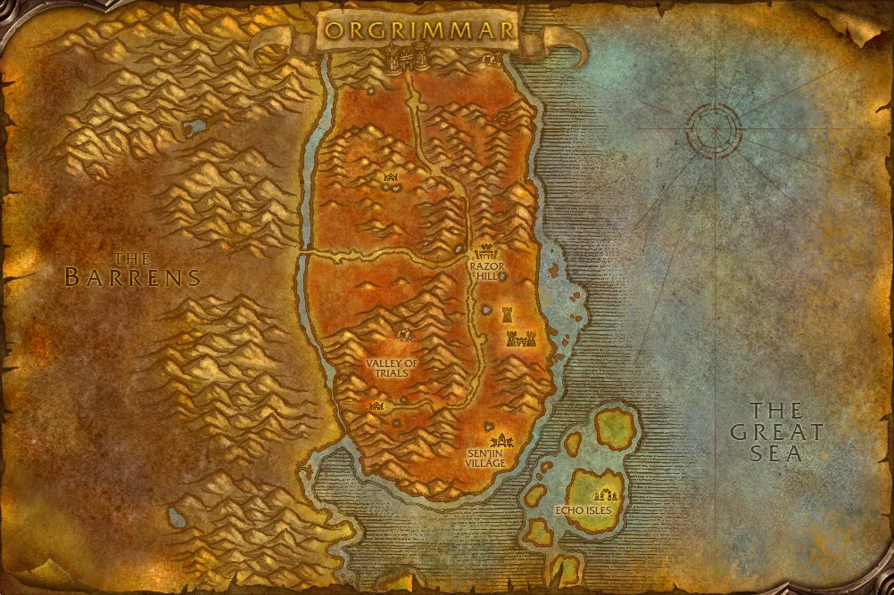

# Výsledek první etapy průvodce WoW Forever

Etapa E00 | 23. října 2026 | Návaznost na implementační plán 1.0

## 1 Výsledek ověření

**Podklady pro zahájení technického prototypu jsou připravené.** Stáhl jsem skutečné mapové obrázky, prověřil veřejné záznamy úkolů a postav a připravil katalog se zdroji a označenými nejistotami. Můžeme navázat etapou E01 a založit nativní Android projekt.

| Hotový výstup | Skutečný rozsah |
| --- | --- |
| Mapové podklady | Čtyři stažené mapy: Azeroth, Kalimdor, Durotar a Orgrimmar. |
| Vzorek katalogu | Devět NPC, devět úkolů, jeden předmět, jedno kouzlo, čtyři návaznosti a jeden dopravní záznam. Celkem 25 záznamů a vztahů. |
| Souřadnice pro další kontrolu | Osm zveřejněných beta poloh NPC a samostatné komunitní reference. |
| Původ a nejistoty | Zdroj každého záznamu, verze dostupných podkladů, osm otevřených kontrol a registr pokrytí. |
| Kontrola souborů a vazeb | Kontrolní otisky map, jedinečnost ID, existence odkazů a ochrana neověřených stavů. |

### Co je doložené a co zbývá ověřit

Blizzard uvádí kombinaci orka a Warlocka za Hordu. [Z1] Úvodní prostředí Valley of Trials v Durotaru a cesta od Kaltunka ke Gornekovi jsou doložené veřejným záznamem z bety. [Z5, Z6] Záznam postavy jiného povolání ale sám nepotvrzuje přesné podmínky všech úkolů pro Warlocka.

U konkrétních herních údajů rozlišuji oznámení Blizzardu, beta pozorování zveřejněné autorem záznamníku, komunitní referenci a sporné pole. Neproběhlo vlastní hraní klienta ani kontrola ve vydané hře. Ani jeden úkol ve vzorku proto nemá označení potvrzeno ve vydané hře.

**E00 je uzavřená pro technický prototyp.** Přesné umístění bodů v nativním prohlížeči ověří E01 a herní obsah první použitelné verze projde kontrolou před M1. Tato etapa neobsahuje hotové APK.

<!-- PAGE -->

## 2 Vybrané mapové podklady

Jako první zdroj jsem vybral veřejně dostupné mapy z WarcraftForever.games s výslovným označením klientské bety 1.60.1.69893. [Z2, Z3, Z4] Všechny čtyři obrázky se podařilo stáhnout, dekódovat a ověřit jejich rozměry. Mají shodně 1002 krát 668 obrazových bodů a formát WebP.

| Mapa | Identifikátor UI mapy |
| --- | --- |
| Azeroth | 947 |
| Kalimdor | 1414 |
| Durotar | 1411 |
| Orgrimmar | 1454 |

Mapový podklad Durotaru. Herní grafika Blizzard Entertainment, převzato z podkladu označeného beta verzí. Zdroj a otisk souboru jsou v inventáři. [Z4]

AzerPug nabízí alternativní mapu Durotaru stejného rozměru. Vizuálně jsem porovnal její podobu; u tohoto zdroje však nebyla doložená konkrétní klientská verze. Pro první vzorek proto zůstává zvolený podklad s označeným sestavením. [Z11]

Rozlišení je dostatečné pro ověření mapového ovládání. Silnější přiblížení nevytvoří nový detail. Aktuálnost geometrie vůči vydané hře zůstává otevřenou kontrolou. Samostatná licence herních map pro veřejnou distribuci nebyla v kontrolovaných zdrojích doložená; původ je uchovaný u každého souboru.

<!-- PAGE -->

## 3 Připravený vzorek úkolů a odměn

Katalog obsahuje následující úkoly. Český text je stručné vlastní vysvětlení; původní název a ID zůstávají zachované pro dohledání ve hře.

| Úkol a ID | Stav podkladu |
| --- | --- |
| Your Place in the World 4641 | Beta záznam, Kaltunk a Gornek. |
| Cutting Teeth 788 | Beta záznam, úvodní zadání od Gorneka. |
| Wayward Weapons 97279 | Beta záznam, Gornek a Kzan Thornslash. |
| Vile Familiars 792 | Beta záznam, obecné zadání od Zureethy. |
| Burning Blade Medallion 794 | Beta záznam od Zureethy. |
| Report to Sen'jin Village 805 | Beta záznam, odevzdání u Master Gadrina. |
| Vile Familiars 1485 | Warlockův záznam; rozpor v potřebném počtu hlav. |
| Vile Familiars 1499 | Samostatná návaznost v komunitním katalogu. |
| Tainted Parchment 3090 | Kandidát úvodního úkolu Warlocka, k ověření ve Forever. |

Prvních šest zadání má samostatné zveřejněné záznamy beta záznamníku. [Z6] U tří Warlockových kandidátů jsme dohledali databázový záznam nebo připnuté komunitní zdroje. Původ je uložený u jednotlivých záznamů, vztahů a rozporných polí; neověřené podmínky se nebudou používat jako potvrzená pravidla. [Z7, Z8, Z9]

### Důležitá odměna a ukázka zdroje předmětu

U úkolu 1485 zveřejněný Forever záznam uvádí naučení Summon Imp. Toto je významný kandidát upozornění pro Warlocka. [Z7] Ve vzorku je také Primitive Walking Stick, ID 5778, s odkazem na beta záznam předmětu a na doložený výběr odměny u úkolu 792. Jiná vazba na odměnu u 1499 zůstává samostatným komunitním tvrzením. [Z8, Z10]

### Pravidla pro další implementaci

Úkoly s názvem Vile Familiars se nesmí slučovat podle jména: ID 792, 1485 a 1499 označují odlišná zadání. Uvedená úroveň úkolu také není důkazem minimální úrovně pro jeho přijetí. Ve vzorku jsou proto všechna neověřená minima null. Aktuální dostupnost pro konkrétní orčího Warlocka bude potřeba ověřit před skutečným doporučováním.

<!-- PAGE -->

## 4 Souřadnice a nalezené rozpory

Osm beta poloh je převzatých z veřejných záznamů konkrétních NPC. Jde o zveřejněná pozorování autora zdroje, nikoliv o naše vlastní měření v klientu. Každá poloha má přímý odkaz a stav kalibrace čeká na E01. [Z5]

| NPC | Durotar x a y |
| --- | --- |
| Kaltunk | 43,1 a 68,7 |
| Gornek | 42,1 a 68,4 |
| Ruzan | 42,7 a 69,0 |
| Zureetha Fargaze | 43,0 a 69,3 |
| Kzan Thornslash | 40,5 a 68,0 |
| Innkeeper Grosk | 51,6 a 41,7 |
| Master Gadrin | 55,6 a 75,0 |
| Frezza | 50,8 a 13,4 |

**Durotar má v mapovém podkladu UI map ID 1411; číslo oblasti 14 patří jinému typu identifikátoru.** V katalogu jsou obě pole oddělená. U Nartoka máme pouze referenční polohu z komunitního katalogu; hlavní beta poloha proto zůstává prázdná.

### Počet hlav pro úkol 1485

Wowhead Forever uvádí šest Vile Familiar Heads. Komentář u objective v připnutém souboru AllTheThings uvádí osm. Komentář v kódu není důkaz aktuálního herního počítadla, ale rozdíl vyžaduje kontrolu. Do účinného cíle nevybírám žádný z počtů; ukládám obě tvrzení se zdroji. Dopad je vysoký pro přesný návod, jistota existence rozporu je vysoká. [Z7, Z8]

### Komunitní návaznosti a doprava

EverythingQuests má v souboru pojmenovaném Forever tabulku CLASSIC_QUEST_AVAILABLE. Obsahuje referenční pravidla i zdrojové souřadnice. Čtyři převzaté návaznosti mají zachované pravidlo ANY a nejsou aktivované pro ověřené směrování. [Z9] Frezza má v beta záznamu uvedenou dopravu k Undercity. Poloha NPC ale sama nepotvrzuje nástupní a výstupní místo; ve vzorku je zatím informační dopravní záznam. [Z5]

<!-- PAGE -->

## 5 Kontrola kvality a návaznost na E01

Vzorek je určený k založení aplikace a ověření práce s mapou. Jednotkou katalogu je entita nebo vztah se stabilním klíčem, nikoliv název. Souřadnice jsou připojené ke konkrétní mapě a zdroji.

| Kontrola | Výsledek |
| --- | --- |
| Stažené mapové soubory | Čtyři ze čtyř odpovídají uloženému kontrolnímu otisku. |
| Jedinečnost klíčů | Všech 25 klíčů entit a vztahů je jedinečných. |
| Původ katalogu | Všech 25 záznamů a vztahů má dohledatelný zdroj. |
| Vazby úkolů a návazností | Žádný odkaz na chybějící NPC nebo úkol ve vzorku. |
| Polohy NPC | Osm z devíti NPC má zveřejněnou beta polohu; zbývající NPC má oddělenou referenci. |
| Kalibrace v Android aplikaci | Nula z osmi míst; tato kontrola patří do E01. |
| Minima úrovně úkolu | Devět z devíti je zatím neověřených a ponechaných prázdných. |
| Potvrzení ve vydané hře | Nula z devíti úkolů; beta a reference zůstávají odlišené. |

Chybějící minima nebo herní potvrzení jsou výslovně evidovaná omezení. Původní pozorování nemají všude datum ani přesné sestavení; datum naší kontroly proto nenahrazuje datum herního měření. Z jednorázového vzorku nelze hodnotit vývoj kvality v čase.

### Převzetí etapy E00

Skutečná mapa je dostupná v souborech, původ poloh je doložený a vzorové záznamy mají stav ověření. Zdrojový dokument, inventář map, vzorek katalogu, registr pokrytí a seznam nejasností jsou součástí předávacího balíčku. Strukturální kontrola je opakovatelná skriptem tools/verify_e00.py a výsledek je v docs/quality_report.json.

### Co provedeme v E01

Založíme Kotlin a Compose projekt, zvolíme a uzamkneme kompatibilní verze nástrojů a připojíme nativní mapovou komponentu. Na skutečném Durotaru zobrazíme doložené beta body, ověříme souřadnice, přiblížení a změnu orientace. Prvním výstupem E01 bude sestavitelné technické APK. Obsahovou kontrolu pro první použitelnou verzi dokončíme před M1.

Úplnost Durotaru zatím není potvrzená. Dungeony, profese a vzácní nepřátelé nejsou součástí tohoto vzorku a zůstávají zaznamenaným dalším obsahem.

<!-- PAGE -->

## 6 Zdroje a předané soubory

Odkazy byly kontrolované 23. října 2026. Podrobný registr zdrojů, verze připnutých souborů a otisky stažených podkladů jsou v předávacím balíčku. Nejsou přiložené celé cizí HTML stránky ani opsané herní příběhové texty.

- **Z1 Blizzard a kombinace ras a povolání.** [Oficiální oznámení](https://news.blizzard.com/en-us/article/24304075/create-the-hero-you-want-to-be-in-world-of-warcraft-forever)
- **Z2 Mapové podklady s verzí bety.** [Katalog map a původ](https://warcraftforever.games/maps)
- **Z3 Přehled světa a kontinentu.** [Azeroth](https://warcraftforever.games/maps/azeroth) a [Kalimdor](https://warcraftforever.games/maps/kalimdor)
- **Z4 Oblast a město.** [Durotar](https://warcraftforever.games/maps/durotar) a [Orgrimmar](https://warcraftforever.games/maps/orgrimmar)
- **Z5 Přímé beta záznamy NPC.** [Kaltunk](https://warcraftforever.games/npcs/10176), [Gornek](https://warcraftforever.games/npcs/3143), [Ruzan](https://warcraftforever.games/npcs/5765), [Zureetha](https://warcraftforever.games/npcs/3145), [Kzan](https://warcraftforever.games/npcs/3159), [Grosk](https://warcraftforever.games/npcs/6928), [Gadrin](https://warcraftforever.games/npcs/3188) a [Frezza](https://warcraftforever.games/npcs/9564)
- **Z6 Přímé beta záznamy úkolů.** [4641](https://warcraftforever.games/quests/4641), [788](https://warcraftforever.games/quests/788), [97279](https://warcraftforever.games/quests/97279), [792](https://warcraftforever.games/quests/792), [794](https://warcraftforever.games/quests/794) a [805](https://warcraftforever.games/quests/805)
- **Z7 Úkol 1485 a odměna Summon Imp.** [Wowhead Forever](https://www.wowhead.com/forever/quest=1485/vile-familiars)
- **Z8 Připnutý komunitní katalog AllTheThings.** Commit 64b17f0be6d062412de564cd20f739c1241a0743, zejména řádky 262 až 269 a 314 až 336. [Soubor Durotar](https://github.com/ATTWoWAddon/AllTheThings/blob/64b17f0be6d062412de564cd20f739c1241a0743/.contrib/.db/forever/zones/kalimdor/durotar.lua)
- **Z9 Připnutá komunitní pravidla EverythingQuests.** Commit 9c1ce1e44238d8c6c8ca36d8f49836fde70b564f. [Dostupnost a její formát](https://github.com/wheelbarrel00/EverythingQuests/blob/9c1ce1e44238d8c6c8ca36d8f49836fde70b564f/Data/QuestAvailable_Forever.lua) a [odevzdání](https://github.com/wheelbarrel00/EverythingQuests/blob/9c1ce1e44238d8c6c8ca36d8f49836fde70b564f/Data/QuestTurnIn_Forever.lua)
- **Z10 Předmět 5778.** [Primitive Walking Stick](https://warcraftforever.games/items/5778)
- **Z11 Alternativní mapa.** [AzerPug Durotar](https://forever.azerpug.com/zones/1411/durotar)
- **Z12 Srovnání původu dat.** [Výslovně označená Classic reference](https://theforeverera.com/en/quests/1499/)
- **Z13 Rozcestník k původním souborům.** [Questing a úkol 1499](https://questing.wiki/wow-forever/quests/1499/)

### Soubory pro další práci

Archiv obsahuje tuto zprávu v textové podobě, skutečné mapové podklady, katalog JSON, zdroje, kontrolní místa, komunitní reference, seznam nejasností, registr pokrytí, stav projektu a ověřovací skript. Původní implementační plán zůstává beze změny; postup E00 a přesný vstup do E01 jsou uložené v docs/POSTUP.md.
